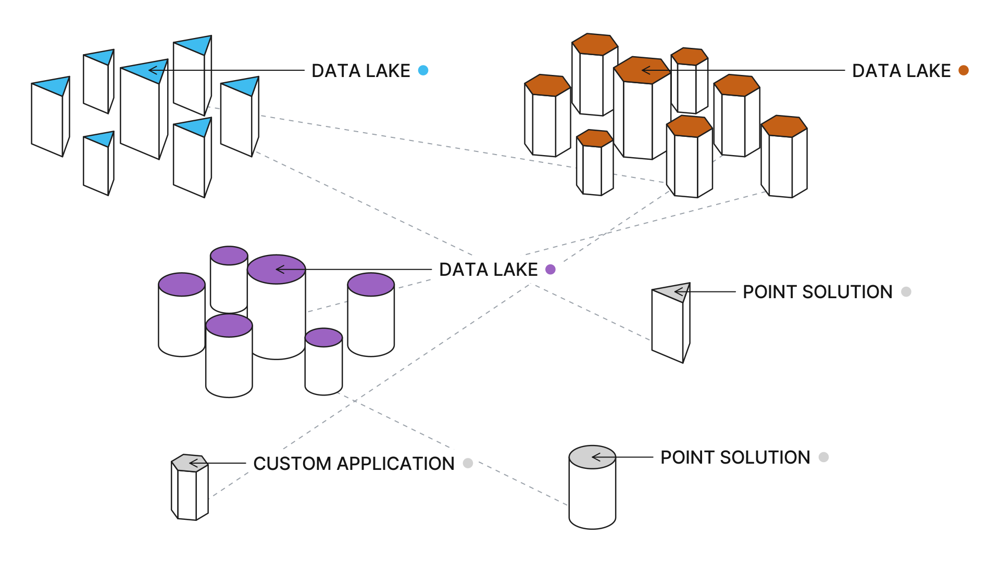

# 인프라 구성 그림 그리기 (infra-diagram)

## 제출물

과제가 요구한 제출물 세 가지의 위치다.

| 제출물 | 위치 |
| --- | --- |
| 1. LLM과의 질답 내용 (공유 URL) | **TODO: 여기에 대화 공유 URL을 적는다** |
| 2. 완성된 코드와 실행 방식이 기록된 sh 파일 | 코드는 [`src/main/java`](src/main/java), 실행 방식은 [`run.sh`](run.sh)에 있다. 사용법은 아래 3번 항목에 적었다 |
| 3. 서로 다른 인프라 구성을 설명하는 입력 데이터 2개 이상과, 각 입력으로 그린 이미지 | [`examples`](examples) 폴더의 입력과 그림 세 쌍이다. 입력과 그림은 이름이 같다. 목록은 아래 1번 항목에 적었다 |

## 1. 프로젝트 설명

채용 과제 "문제 3. 모호한 요구사항을 코드로 정의하기"의 풀이다. 과제의 요구는 다음 문장이다.

> 임의의 인프라 구성을 설명하는 데이터를 입력으로 받아, 그 구성을 삼각기둥/원기둥/육각기둥이 Cluster를 이루는 그림으로 새로 그려 내는 프로그램을 만들어 주세요.

- 서비스를 소개하는 PPT에 넣을 그림이며, 과제에 첨부된 예시 그림과 비슷한 느낌이어야 한다.
- 서비스마다 구성이 다르다. 과제는 "데이터 소스가 셋뿐인 서비스도 있고, 애플리케이션이 열 개가 넘는 서비스도 있습니다"라고 했다.
- 이미지 생성 AI에게 그림을 맡기면 안 되고 코드로 그려야 한다.
- "처음 보는 입력이 들어와도 PPT에 넣을 만한 퀄리티의 이미지"가 나와야 한다.

이 프로그램은 JSON 파일 하나를 읽어 PNG 그림 하나를 만든다. 기둥의 자리와 모양을 모두 좌표로 계산해서 그리며, 같은 입력은 언제나 같은 그림이 된다.

과제에는 입력의 형식도, 입력의 무엇이 그림의 무엇이 되는지도, 좋은 그림의 기준도 적혀 있지 않다. 과제는 이것을 "정의해야 할 대상"이라고 했다. 이 문서의 4번부터 6번까지가 그 빈 곳을 어떻게 정했고 왜 그렇게 정했는지를 적은 부분이다.

서로 다른 구성의 입력 세 개와 그 그림이 `examples` 폴더에 있다. 입력과 그림은 이름이 같다.

| 입력 | 그림 | 구성 |
| --- | --- | --- |
| [`examples/reference-like.json`](examples/reference-like.json) | [`reference-like.png`](examples/reference-like.png) | 과제의 예시 그림과 닮은 구성. 요소가 여럿인 무리 3개와 홀로 있는 요소 3개, 연결 5개 |
| [`examples/many-applications.json`](examples/many-applications.json) | [`many-applications.png`](examples/many-applications.png) | 과제가 말한 "애플리케이션이 열 개가 넘는 서비스". 요소 18개가 무리 4개를 이루고 글자가 한글이다 |
| [`examples/three-data-sources.json`](examples/three-data-sources.json) | [`three-data-sources.png`](examples/three-data-sources.png) | 과제가 말한 "데이터 소스가 셋뿐인 서비스". 요소 3개가 한 무리를 이룬다 |



## 2. 요구 환경

- **자바**: 컴파일과 실행에는 JDK 25를 쓴다. 직접 설치하지 않아도 된다. Gradle이 PC에 깔린 JDK 25를 찾아 쓰고, 없으면 처음 한 번 내려받는다. 다만 Gradle 자체를 띄울 자바(17 이상)는 PC에 있어야 한다. `java -version`으로 확인한다.
- **Gradle**: 설치하지 않는다. 저장소에 든 Gradle Wrapper(`gradlew`, `gradlew.bat`)가 Gradle 9.9.1을 내려받아 쓴다.
- **인터넷**: 처음 빌드할 때 Gradle, 라이브러리, (없으면) JDK 25를 내려받는다.
- **라이브러리**: JSON을 읽는 Jackson 3.3.0, 테스트에 쓰는 JUnit Jupiter 6.1.3. 스프링 같은 프레임워크는 쓰지 않는다.
- **글꼴**: Pretendard Medium이 프로그램에 들어 있다(SIL Open Font License 1.1, `src/main/resources/fonts`). PC에 깔린 글꼴에 기대지 않는다.
- **운영체제**: macOS, Linux, Windows. 경로, 줄바꿈, 인코딩을 한 운영체제에 기대지 않게 썼다. 이 저장소의 자동 확인은 Linux에서 했다.

## 3. 빌드, 테스트, 실행

### macOS, Linux

```bash
./gradlew build
```

```bash
./gradlew test
```

```bash
./run.sh
```

```bash
./run.sh examples/reference-like.json my-picture.png
```

- `./gradlew build`는 컴파일과 테스트를 함께 한다.
- `./run.sh`는 인자 없이 실행하면 `examples` 폴더의 입력을 모두 그려 같은 이름의 PNG로 저장한다. 입력 파일과 출력 파일을 주면 그 입력만 그린다. 테스트는 실행하지 않는다.
- `run.sh`는 Gradle로 컴파일만 하고, 프로그램은 Gradle이 고른 JDK 25로 직접 띄운다. 그래서 프로그램의 안내문과 종료 코드가 그대로 전달된다.

### Windows (PowerShell 또는 명령 프롬프트)

```powershell
.\gradlew.bat build
```

```powershell
.\gradlew.bat test
```

```powershell
.\gradlew.bat run --args="examples/reference-like.json examples/reference-like.png"
```

```powershell
.\gradlew.bat run --args="examples/many-applications.json examples/many-applications.png"
```

```powershell
.\gradlew.bat run --args="examples/three-data-sources.json examples/three-data-sources.png"
```

- `gradlew.bat run`에 주는 상대 경로는 프로젝트 폴더를 기준으로 한다.
- 입력이 거부되면 프로그램의 안내문 뒤에 Gradle의 `FAILURE: Build failed` 안내가 덧붙는다. 프로그램이 실패로 끝났다는 뜻이며, 고칠 곳은 그 위에 나온 프로그램의 안내문에 있다.
- Git Bash가 있으면 `bash run.sh`로 macOS와 같은 방식으로 실행할 수 있다. 이 방식은 Windows에서 확인하지 못했다.

### 종료 코드와 안내문

| 종료 코드 | 뜻 | 터미널에 나오는 글 |
| --- | --- | --- |
| 0 | 그림을 저장했다 | `Wrote <그림 파일>` |
| 1 | 입력이 규칙에 어긋나거나, 그려 보니 품질 조건을 어긴다. 그림 파일을 만들지 않는다 | `Invalid input: ...` 또는 `This input cannot be drawn with acceptable quality.` |
| 2 | 인자의 수가 맞지 않는다 | `Usage: ...` |

터미널에 나오는 글은 영어다. 터미널의 인코딩 설정에 따라 한글이 깨질 수 있기 때문이다.

## 4. 입력 데이터의 형식과 범위

### 형식

입력은 UTF-8로 저장한 JSON 파일 하나다. 파일 맨 앞에 BOM이 붙어 있어도 읽는다. BOM은 Windows의 일부 도구가 UTF-8 파일 맨 앞에 붙이는 보이지 않는 표시다.

```json
{
  "clusters": [
    { "elements": [
        { "id": "order-db", "scale": "large", "core": true, "label": "주문 DB" },
        { "id": "customer-db", "label": "고객 DB" },
        { "id": "log-store", "scale": "small" }
    ] },
    { "elements": [ { "id": "chatbot", "label": "상담 챗봇" } ] }
  ],
  "links": [ { "between": ["chatbot", "order-db"] } ]
}
```

| 항목 | 필수 | 뜻 | 규칙 |
| --- | --- | --- | --- |
| `clusters` | 예 | 무리의 목록. 무리는 함께 묶여 그려지는 요소들이다 | 1개 이상 |
| `clusters[].elements` | 예 | 그 무리에 속한 요소의 목록 | 1개 이상. 요소가 하나뿐이면 "홀로 있는 요소"다 |
| `id` | 예 | 요소를 가리키는 이름. 연결에서 요소를 지목할 때 쓴다. 그림에는 적히지 않는다 | 빈 값 불가. 입력 전체에서 겹치지 않아야 한다 |
| `scale` | 아니오 | 요소의 규모 | `small`, `medium`, `large` 중 하나. 생략하면 `medium` |
| `core` | 아니오 | 무리의 중심 요소인지 | `true` 또는 `false`. 생략하면 `false`. 한 무리에 하나까지 |
| `label` | 아니오 | 그림에 적을 글자. 적은 그대로 그린다 | 빈 값 불가. 한 줄. 글꼴이 그릴 수 있는 글자(한글, 영문, 숫자, 흔한 기호) |
| `links` | 아니오 | 요소 사이의 연결 목록. 방향이 없다 | 생략하면 연결이 없다 |
| `links[].between` | 예 | 이을 두 요소의 `id` | 정확히 2개. 있는 요소여야 하고, 서로 달라야 하고, 같은 쌍을 두 번 적을 수 없다 |

근거는 다음과 같다.

- **JSON**: 무리 안에 요소가 들어가는 겹친 구조를 그대로 적을 수 있고, 가장 널리 쓰이는 형식이다.
- **무리를 직접 적는다**: 과제는 "임의의 인프라 구성"이라고만 했다. 데이터 소스가 반드시 있다거나 요소에 정해진 역할이 있다는 말이 없다. 그래서 "데이터 소스", "애플리케이션" 같은 역할을 입력에 두지 않고, 무엇이 한 무리인지만 받는다.
- **`id`와 `label`을 나눈다**: 요소를 가리키는 이름과 그림에 적는 글자는 쓰임이 다르다. 하나로 합치면 같은 글자를 가진 요소 둘을 구별할 수 없고(예시 그림의 "DATA LAKE" 셋), 글자를 적고 싶지 않은 요소를 연결에서 가리킬 수 없다.
- **모든 요소는 정확히 한 무리에 속한다**: 홀로 있는 요소를 따로 적는 자리를 두지 않고 "요소 하나뿐인 무리"로 적는다. 규칙이 하나로 줄어든다.
- **맨 앞의 BOM은 건너뛴다**: BOM이 붙어도 내용은 올바른 UTF-8이다. 거부하면 눈에 보이지 않는 글자 때문에 "1번째 줄 1번째 칸" 오류가 나와서 입력을 쓴 사람이 고치기 어렵다. 맨 앞의 하나만 건너뛰며, UTF-8이 아닌 파일(예: CP949)은 그대로 거부한다.

### 범위

| 항목 | 상한 | 근거 |
| --- | --- | --- |
| 무리의 수 | 12개 | 과제가 "애플리케이션이 열 개가 넘는 서비스"를 말한다. 홀로 있는 요소만 늘어놓아도 열 개를 넘길 수 있는 수로 잡았다 |
| 요소가 둘 이상인 무리의 수 | 6개 | 무리마다 겹치지 않는 색을 주는데, 서로 쉽게 구별되는 색이 여섯 가지까지다(6번 참조) |
| 한 무리의 요소 수 | 19개 | 가운데 1개, 첫째 고리 6개, 둘째 고리 12개를 꽉 채운 수 |
| 한 무리에서 글자를 붙이는 요소의 수 | 3개 | 예시 그림은 무리마다 하나에만 글자를 붙였다. 중심 요소와 눈여겨볼 요소 두어 개를 설명하기에 충분하고, 더 많으면 화살표가 얽히고 글자가 작아진다 |
| 글자의 길이 | 20자 | 사람이 세는 글자 수로 센다. 예시 그림의 가장 긴 글자 "CUSTOM APPLICATION"이 18자다 |

최솟값은 무리 1개, 한 무리의 요소 1개, 글자 1자다. 연결의 수에는 상한이 없다.

### 상한 안이어도 거부되는 경우와 항상 그려지는 범위

상한은 넉넉하게 두었다. 그래서 상한 안이어도 요소와 글자가 많으면 그림 전체가 줄어들어 글자가 읽을 수 없게 작아질 수 있다. 이 프로그램은 그려 본 결과로 판정한다. 그려 본 그림이 5번의 품질 조건을 어기면 저장하지 않고, 무엇이 얼마나 모자라는지와 고치는 방법을 알린다.

```text
This input cannot be drawn with acceptable quality.
  - Labels would be drawn 15.6 px high. The minimum is 18.0 px.
Use fewer elements, fewer labels, or shorter labels.
An input always fits when it has at most 6 clusters, at most 3 of them with two or more elements, at most 8 elements per cluster, and labels written in Korean or ASCII characters.
```

미리 알 수 있는 기준으로 **항상 그려지는 범위**를 둔다.

- 무리 6개 이하, 그 가운데 요소가 둘 이상인 무리 3개 이하, 한 무리의 요소 8개 이하.
- 이 범위 안이면 글자를 상한까지(무리마다 3개, 20자) 붙여도 그려진다. 글자는 한글과 영문, 숫자, 흔한 기호를 기준으로 한다.
- 과제의 예시 그림은 요소가 여럿인 무리가 3개다. 그와 닮게 만든 `examples/reference-like.json`(요소가 여럿인 무리 3개와 홀로 있는 요소 3개)이 이 범위에 들어간다.

이 범위는 수학으로 증명한 것이 아니라 찾아서 확인한 것이다. 범위 안의 입력을 무작위로 수만 개 만들고, 가장 불리한 것들을 조금씩 바꿔 가며 글자가 더 작아지는 입력을 찾았다. 아래 표가 그렇게 찾은 가장 작은 글자 크기다. 글자는 글꼴에서 가장 넓은 글자인 W로 20자를 무리마다 3개씩 붙였다.

| 범위 | 가장 작은 글자 크기 | 기준 18픽셀 |
| --- | --- | --- |
| 무리 6개, 요소가 둘 이상인 무리 3개, 한 무리의 요소 8개 (항상 그려지는 범위) | 19.2픽셀 | 지킴 |
| 위에서 무리만 7개로 | 17.9픽셀 | 어김 |
| 위에서 요소가 둘 이상인 무리만 4개로 | 16.6픽셀 | 어김 |
| 위에서 한 무리의 요소만 12개로 | 16.5픽셀 | 어김 |
| 입력 상한 전체 (무리 12개, 요소가 둘 이상인 무리 6개, 한 무리의 요소 19개) | 10.5픽셀 | 어김 |

- 범위 밖이라고 모두 거부되는 것은 아니다. `examples/many-applications.json`은 한 무리의 요소가 9개여서 범위 밖이지만 글자가 짧고 적어서 잘 그려진다.
- 글자가 하나도 없는 입력은 상한 안이면 가장 불리한 경우에도 기둥 반지름이 19.4픽셀로, 기준인 12픽셀을 넘는다.
- 범위 안인데도 조건을 어기는 입력이 혹시 있더라도, 실행할 때의 품질 검사가 그 그림을 저장하지 않는다.

### 거부하는 입력

규칙에 어긋나는 입력은 고쳐서 그리지 않고 모두 거부하며, 어디가 왜 틀렸는지 알린다. 조용히 고쳐 그리면 입력을 쓴 사람이 의도와 다른 그림을 받고도 모르기 때문이다.

- JSON 문법 오류: 줄과 칸을 알린다.
- 모르는 항목(오타): 항목의 경로와 쓸 수 있는 항목을 알린다. 예: `Unknown field 'scael' at clusters[0].elements[1].scael. Allowed fields: core, id, label, scale.`
- 값의 종류가 틀림(글자 자리에 숫자 등), 같은 항목을 두 번 적음, 빈 입력.
- 무리가 없음, 빈 무리, `id`가 없거나 겹침, 모르는 `scale`, 한 무리에 중심 요소가 둘, 빈 글자, 그릴 수 없는 글자나 줄바꿈이 든 글자.
- 연결이 두 요소를 잇지 않음, 없는 요소를 가리킴, 자기 자신과 이음, 같은 연결을 두 번 적음(순서만 바꾼 것 포함).
- 상한을 넘음.

## 5. 입력의 각 요소가 그림의 무엇이 되는지

| 입력 | 그림 | 근거 |
| --- | --- | --- |
| 요소 하나 | 기둥 하나. 흰 면에 검은 선 | 예시 그림이 요소를 꾸밈없는 기둥으로 그린다 |
| 무리 | 한곳에 모인 같은 모양의 기둥들. 모양은 무리의 순서대로 삼각기둥, 육각기둥, 원기둥을 돌려 쓴다 | 과제가 "삼각기둥, 원기둥, 육각기둥이 무리를 이룬다"고 했고, 예시 그림에서 한 무리는 한 모양이다 |
| 무리(요소가 둘 이상) | 그 무리 기둥의 윗면을 모두 무리의 색으로 칠한다. 색은 여섯 가지이고 무리마다 겹치지 않는다 | 모양은 세 가지뿐이라 넷째 무리부터 모양이 겹친다. 색으로 무리를 구별한다 |
| 무리(요소가 하나) | 윗면이 회색인 기둥 | 묶을 것이 없으므로 색을 쓰지 않는다. 색은 무리를 구별하는 데 아껴 쓴다 |
| `scale` | 기둥의 크기. 반지름이 소 0.8, 중 1, 대 1.25의 비율이고 높이는 반지름의 3배다 | 예시 그림에 굵고 높은 기둥과 가늘고 낮은 기둥이 섞여 있다. 굵기와 높이가 함께 변하게 했다 |
| `core` | 무리의 가운데 자리 | 예시 그림에서 글자가 가리키는 큰 기둥이 무리의 가운데에 있다 |
| 요소를 적은 순서 | 가운데에서 바깥으로 놓이는 순서. 중심 요소가 없으면 먼저 적은 요소가 가운데에 놓인다 | 순서를 입력이 정하게 하면 무작위가 필요 없고 같은 입력이 같은 그림이 된다 |
| `label` | 기둥 곁의 글자, 글자에서 기둥 윗면 가운데까지 가는 화살표, 글자 옆의 무리 색 점 | 예시 그림의 글자, 화살표, 색 점을 따랐다. 한 무리에 글자가 여럿이어도 어느 기둥인지 알 수 있게 화살표를 윗면까지 잇는다 |
| `links` | 두 기둥의 바닥 가운데를 잇는 곧은 회색 점선. 기둥 뒤로 지나간다 | 예시 그림의 점선을 따랐다. 점선이 기둥을 덮으면 기둥의 모양을 읽기 어렵다 |
| 무리를 적은 순서 | 왼쪽에서 오른쪽으로, 위에서 아래로 놓이는 순서 | 순서를 입력이 정한다 |

### 그리는 방식

- **평행 투영**: 멀리 있는 것을 작게 그리지 않고, 비스듬히 내려다본 모습을 같은 크기로 그리는 방식이다. 같은 규모의 기둥은 어디에 있든 같은 크기로 그려져 크기를 비교할 수 있다. 내려다보는 각도는 30도다. 바닥의 앞뒤 거리는 화면에서 절반으로 눌리고(30도의 사인), 높이는 약 0.87배가 된다(30도의 코사인).
- **무리 안의 자리**: 가운데 한 자리, 그 둘레에 여섯 자리, 그 바깥에 열두 자리가 있는 벌집 모양이다. 고리를 다 채우지 못하면 한쪽에 몰지 않고 고르게 띄운다. 기둥 사이의 거리는 아래 품질 조건을 지키는 가장 촘촘한 거리로 계산한다.
- **무리끼리의 자리**: 입력 순서대로 줄지어 놓고, 줄마다 조금씩 엇갈리게 한다. 줄 수는 그림에 가장 크게 들어가는 것으로 고른다.
- **그림 파일**: PNG, 가로 1920픽셀과 세로 1080픽셀(16대 9), 흰 바탕. 내용은 가장자리에서 60픽셀 안쪽에, 가운데에 놓인다.

### 품질 조건

과제의 "PPT에 넣을 만한 퀄리티"를 검사할 수 있는 조건 일곱 가지로 정했다.

1. 기둥의 바닥끼리 겹치지 않는다.
2. 모든 기둥의 윗면이 다른 기둥에 가려지지 않는다. 몸통은 앞 기둥에 가려져도 된다.
3. 서로 다른 무리 사이의 틈이 무리 안의 기둥 사이 틈보다 넓다.
4. 글자가 기둥이나 다른 글자와 겹치지 않는다.
5. 기둥과 글자가 가장자리 여백 안쪽에 있다.
6. 가장 작은 기둥의 반지름이 12픽셀 이상이다.
7. 글자의 크기가 18픽셀 이상이다. 그림을 슬라이드에 꽉 채웠을 때 약 9포인트다.

## 6. 과제에 없어서 정한 것과 이유

4번과 5번에 적은 것 외에 정한 것이다.

| 정한 것 | 이유 |
| --- | --- |
| 무리의 이름은 받지 않고 그리지 않는다 | 예시 그림에 무리의 이름이 없다. 글자는 요소에 붙는다 |
| 색은 여섯 가지이고 돌려 쓰지 않는다 | 색 차이를 계산하는 도구로 확인했다. 어느 두 무리든 이웃할 수 있다는 조건에서, 여섯 색은 가장 비슷한 두 색의 차이가 17.8로 쉽게 구별된다고 보는 기준 15를 넘는다. 여덟 색이면 12.7로 떨어진다. 적록 색각에서도 여섯 색은 9.3으로 목표 8을 넘는다 |
| 윗면은 옅게 하지 않고 모두 진하게 칠한다 | 옅은 색은 네 가지만 되어도 서로 구별되지 않았다(차이 6.3) |
| 예시 그림의 하늘색은 "글자가 가리키는 기둥의 표시"로 해석했다 | 예시 그림에서 하늘색은 글자 옆의 점과 기둥 윗면에 함께 쓰인다. 화살표만으로는 어느 기둥인지 알기 어려워 색으로 짝을 지은 것으로 보았다. 이 프로그램에서는 무리의 색이 그 역할을 한다 |
| 윗면은 모두 보이게 하고 몸통은 가려져도 된다 | 윗면이 가려지면 기둥의 수와 모양을 셀 수 없다. 몸통까지 안 가리게 하면 무리가 흩어져 한 무리로 보이지 않는다 |
| 글자는 자기 무리의 바깥 둘레에, 기둥에 가까운 쪽에 놓는다 | 글자가 기둥 위에 놓이면 서로 가린다. 바깥에 두면 겹치지 않는다는 것을 계산 없이 보장할 수 있다 |
| 그림의 크기는 16대 9로 고정한다 | 과제가 슬라이드에 넣을 그림을 말한다. 요즘 슬라이드의 기본 비율이다 |
| 출력은 PNG다 | 어느 슬라이드 도구에나 그대로 넣을 수 있다 |
| 글꼴을 프로그램에 넣는다 | PC마다 깔린 글꼴이 달라 글자의 폭이 달라지면 같은 입력이 다른 그림이 된다. 한글도 그릴 수 있어야 한다 |
| 무작위를 쓰지 않는다 | 같은 입력이 같은 그림이 되어야 결과를 설명하고 테스트할 수 있다 |
| 요소가 적으면 그림을 끝없이 키우지 않는다 | 중간 규모 기둥의 반지름이 60픽셀을 넘지 않게 한다. 요소 세 개짜리 예제를 한도 90픽셀로도 그려 비교했다. 키우면 여백은 줄지만 글자가 48픽셀에서 72픽셀로 커지고 선 굵기는 그대로여서, 요소가 많은 그림과 한 자료에 넣었을 때 느낌이 달라진다 |
| 예제는 세 개, `run.sh`는 인자 없이 예제 모두 | 과제가 서로 다른 구성의 입력 2개 이상과 그 그림, 실행 방식이 적힌 sh 파일을 요구한다 |

## 7. 구조와 확장 방법

입력 파일이 그림 파일이 되기까지 네 단계를 거친다. 단계마다 꾸러미(패키지)가 하나씩 있고, 앞 단계의 결과만 받아 쓴다.

```text
입력 파일 ─(input)→ 인프라 구성 ─(layout)→ 장면 ─(quality)→ 검사를 통과한 장면 ─(render)→ PNG 파일
             model                scene
```

| 꾸러미 | 하는 일 |
| --- | --- |
| `model` | 인프라 구성. 무리, 요소, 연결. 그림에 관한 것은 모른다 |
| `input` | JSON을 읽어 `model`로 바꾸고 규칙에 어긋나면 거부한다 |
| `scene` | 장면. 어디에 무엇을 그릴지를 좌표로 적은 것. 기둥, 점선, 글자 |
| `layout` | `model`을 `scene`으로 바꾼다. 투영, 무리 안의 자리, 무리끼리의 자리, 글자의 자리, 그림 크기에 맞추기 |
| `quality` | 장면이 품질 조건 일곱 가지를 지키는지 검사한다 |
| `render` | 장면을 PNG로 그린다. 글꼴과 색 |
| `settings` | 그림을 보고 정한 값(각도, 크기, 틈, 선 굵기, 최소 크기, 상한)을 한 곳에 모은다 |
| `app` | 명령줄 인자를 받아 위 단계를 차례로 실행한다 |

자리 계산(`layout`)과 그리기(`render`)를 나눈 이유는 두 가지다. 품질 조건을 그림 파일이 아니라 좌표로 검사할 수 있고, 테스트가 그림을 열어 보지 않고도 자리를 확인할 수 있다.

확장할 때 고칠 곳은 다음과 같다.

| 하고 싶은 것 | 고칠 곳 |
| --- | --- |
| 다른 형식의 입력(YAML 등) | `input.InfrastructureReader`를 구현한다 |
| 입력 규칙 추가 | `input.InputRule`을 구현해 `InputRules`에 더한다 |
| 품질 조건 추가 | `quality.QualityRule`을 구현해 `QualityInspector`에 더한다 |
| 다른 형식의 출력(SVG 등) | `render.SceneRenderer`를 구현한다 |
| 기둥 모양 추가 | `scene.PillarShape`에 값을 더하고, `render.PillarPainter`를 구현해 `PngSceneRenderer`에 등록한다 |
| 크기, 틈, 각도, 상한 바꾸기 | `settings.StandardSettings`의 값을 고친다 |
| 색 바꾸기 | `render.Palette`의 값을 고친다 |

코딩 규칙: 클래스는 120줄, 메서드는 10줄 이내로 썼다. 주석은 핵심 계산과 이해하기 어려운 곳에만 "왜 그렇게 계산하는지"를 예시와 함께 적었다.

## 8. 테스트 구성과 근거

테스트는 "이 테스트가 없으면 어떤 실수를 놓치는가"에 답할 수 있는 것만 두었다. 여섯 종류로 나뉜다.

| 종류 | 잡는 실수 | 테스트 |
| --- | --- | --- |
| 요건 규칙 | 정한 규칙이 어떤 입력에서는 깨지는 실수 | `DrawnSceneQualityTest`(여러 구성을 그린 결과가 품질 조건을 모두 지킨다), `GuaranteedRangeTest`(항상 그려지는 범위), `ClusterStylesTest`(색과 모양의 규칙), `SceneLayoutTest`(요소마다 기둥 하나, 같은 입력은 같은 그림), `PaletteTest` |
| 검산한 정답 | 규칙은 지키지만 값이 틀린 계산 | `ProjectionTest`, `RingSlotsTest`, `TopClearanceTest`, `ClusterPitchTest`, `RowPackerTest`, `CanvasFitTest`, `LabelPlacerTest`. 작은 입력을 손으로 계산한 좌표와 비교한다 |
| 경계값 | 상한과 최솟값을 한 칸 틀리게 판정하는 실수 | `LimitsTest`(상한마다 최솟값, 최댓값, 하나 넘는 값), `QualityRulesTest`(최소 크기와 같을 때와 바로 아래) |
| 계산 방식이 바뀌는 지점 | 한쪽 경우만 맞고 다른 경우가 틀린 계산 | `RingSlotsTest`(고리가 넘어가는 여덟째, 다 채우지 못한 고리), `ClusterPitchTest`(높은 기둥이 앞일 때와 뒤일 때), `LabelPlacerTest`(왼쪽과 오른쪽, 글자를 아래로 내리는 경우), `ClusterTest`(중심 요소가 있을 때와 없을 때) |
| 틀렸던 곳 | 한 번 고친 결함이 되살아나는 실수 | `RowPackerTest`(크기가 다른 덩어리가 섞이면 좋은 줄 나눔을 놓치던 결함), `StructureRejectionTest`(모르는 항목의 위치가 "줄 -1"로 나오던 결함), `ReadingTest`(맨 앞에 BOM이 붙은 UTF-8 파일이 알기 어려운 안내와 함께 거부되던 결함), `RingSlotsTest`(둘째 고리의 첫 자리가 동떨어져 보이던 결함) |
| 잘못된 입력 | 거부해야 할 입력을 받아들이거나 엉뚱한 이유를 알리는 실수 | `StructureRejectionTest`, `ElementRejectionTest`, `LinkRejectionTest`, `DisplayableLabelRuleTest`, `DiagramCommandTest`. 거부할 값을 종류별로 하나씩 넣고 안내문을 확인한다 |

- `GuaranteedRangeTest`는 항상 그려지는 범위에서 무리의 순서와 크기를 빠짐없이 훑는다. 실제 글꼴과 표준 설정으로 입력 27,000여 개를 그려 품질 조건을 확인하며 8초쯤 걸린다. 범위를 일부러 넓히면(한 무리의 요소 12개, 또는 요소가 둘 이상인 무리 4개) 이 테스트가 실패하는 것을 확인했다. 4번의 표를 만든 탐색보다는 덜 촘촘하다.
- `DiagramCommandTest`는 프로그램 전체를 실행한다. 올바른 입력은 그림 파일을 만들고 0으로, 잘못된 입력과 상한 안이지만 글자가 작아지는 입력은 파일을 만들지 않고 1로, 인자가 틀리면 2로 끝나는지 확인한다.
- 그림이 보기 좋은지는 테스트가 판정하지 못한다. 예제 그림을 직접 열어 확인했다.

## 9. 과제 범위를 넘는 추가 스펙

- **실행할 때의 품질 검사**: 그림을 저장하기 전에 5번의 품질 조건 일곱 가지를 검사하고, 어긴 그림은 저장하지 않는다. 품질 조건을 테스트에서만 확인하면 테스트하지 않은 입력에서 나쁜 그림이 나와도 알 수 없다. 실행할 때마다 검사하면 "이 프로그램이 저장한 그림은 조건을 지킨다"고 말할 수 있다.

## 10. 문제 해결

| 증상 | 대처 |
| --- | --- |
| `./run.sh: Permission denied` | `chmod +x run.sh`를 실행하거나 `bash run.sh`로 실행한다 |
| `bad interpreter` 또는 `$'\r': command not found` | `run.sh`의 줄바꿈이 Windows 방식으로 바뀐 것이다. 저장소의 `.gitattributes`가 이를 막지만, 압축 파일로 옮겼다면 `tr -d '\r' < run.sh > run.tmp && mv run.tmp run.sh && chmod +x run.sh`로 고친다 |
| `JAVA_HOME is not set and no 'java' command could be found` | Gradle을 띄울 자바가 없다. JDK 17 이상을 설치한다. JDK 25를 설치하면 내려받기 없이 바로 쓴다 |
| JDK 25를 내려받지 못한다(회사 방화벽, 인터넷 없음) | JDK 25를 직접 설치한다. Gradle이 PC에 깔린 JDK를 스스로 찾는다 |
| 라이브러리를 내려받지 못한다(`Could not resolve`, `429`) | 잠시 뒤 다시 실행한다. 한 번 받은 뒤에는 `./gradlew build --offline`으로 인터넷 없이 빌드할 수 있다 |
| `Cannot read input file ... Check that it exists and is UTF-8 text.` | 파일 경로를 확인한다. 경로가 맞으면 파일이 UTF-8이 아닌 것이다(예: CP949). UTF-8로 다시 저장한다 |
| `This input cannot be drawn with acceptable quality.` | 요소나 글자를 줄이거나 글자를 짧게 한다. 4번의 "항상 그려지는 범위"를 참고한다 |
| `contains a character that cannot be drawn` | 글자에 그림 문자(이모지)나 줄바꿈이 들어 있다. 한글, 영문, 숫자, 흔한 기호로 한 줄에 적는다 |
| Windows에서 `gradlew.bat run` 뒤에 `FAILURE: Build failed`가 나온다 | 프로그램이 입력을 거부했다는 뜻이다. 그 위에 나온 프로그램의 안내문을 본다 |
